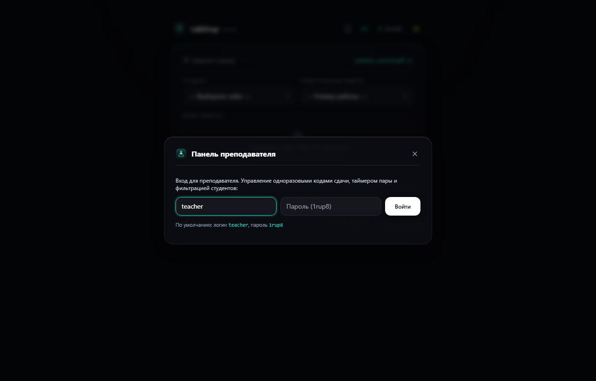
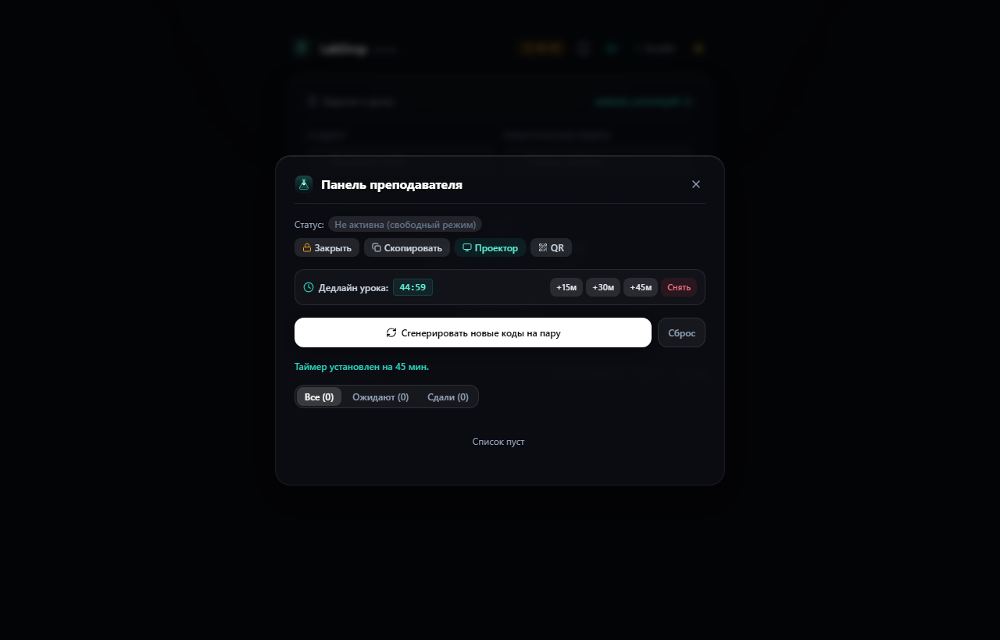
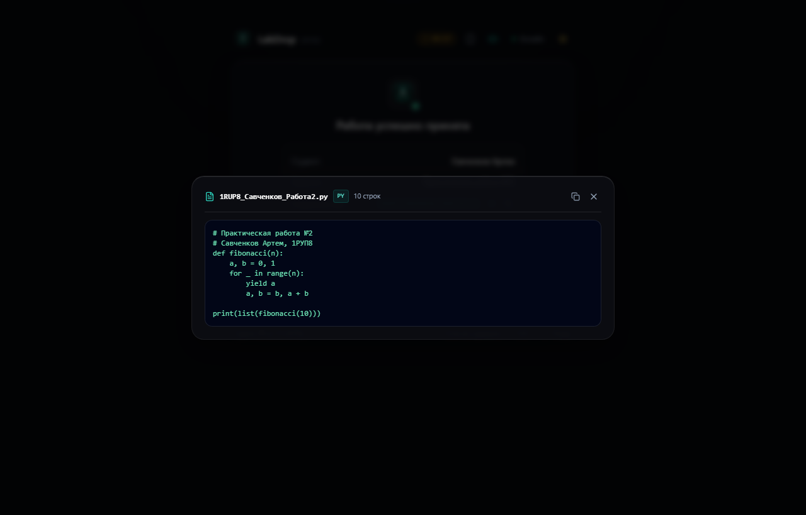
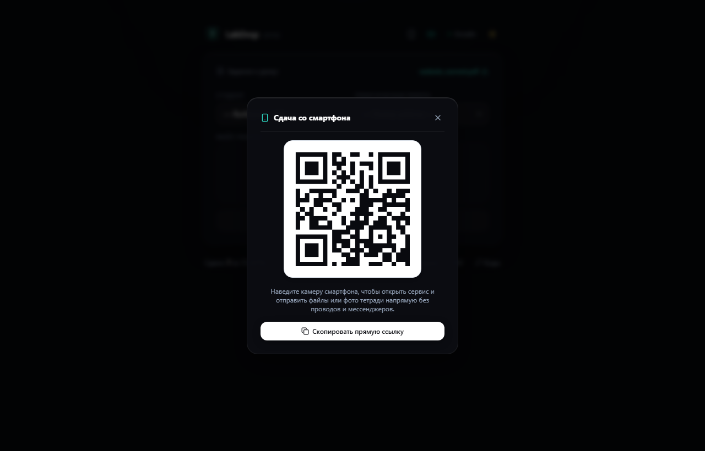

<p align="center">
  
</p>

# LabDrop | 1РУП8

> **Локальный веб-сервис для мгновенной сдачи практических работ в компьютерных кабинетах колледжа без ввода личных аккаунтов.**

[](https://nextjs.org/)
[]()
[-10b981.svg)]()
[]()
[]()

---

## 👥 Авторы проекта

- **Савченков Артем** — разработка фронтенда, клиентская валидация, интерфейс Glassmorphism & Minimalist Obsidian, адаптивная верстка, тестирование пользовательских сценариев.
- **Алиев Марат** — разработка бэкенда, маршрутизация API, контроль версий Git, архитектура сохранения файлов и аудит безопасности по методике Strix SecOps.

**Учебная группа:** 1РУП8  
**Репозиторий:** [github.com/maratello1/college](https://github.com/maratello1/college)  
**Онлайн-демо (временный HTTPS-домен):** [hunger-caution-femur.ngrok-free.dev](https://hunger-caution-femur.ngrok-free.dev) *(при первом входе нажмите кнопку «Visit Site»)*

---

## 🎯 Проблема и решение

### В чем проблема на парах?
1. **Вход в аккаунты на общих компьютерах:** чтобы скачать методичку или сдать файл, студенту приходится заходить в свой личный Google Диск или мессенджер Макс (российский мессенджер) с чужого компьютера.
2. **Угроза безопасности:** на перемене студенты спешат и часто забывают выйти из личных учетных записей, оставляя доступ к личной переписке и файлам следующим группам.
3. **Потеря учебного времени:** при медленном интернете в кабинете страница авторизации мессенджера Макс или Google грузится по несколько минут. В сумме группа теряет до 15% времени урока только на логины.
4. **Сдача работ с чужого имени:** в спешке студенты могут выбрать фамилию соседа или загрузить чужую работу.
5. **Хаос в названиях файлов:** студенты прикрепляют файлы с именами вроде `1.docx`, `готово.py`, `lab.pdf`. Преподавателю приходится вручную открывать каждый файл, чтобы понять, чья это работа.

### Как решает LabDrop?
- **0 авторизаций для студентов:** студент садится за компьютер, открывает страницу в локальной сети и сразу работает.
- **1 клик до задания:** кнопка «Скачать задание» моментально отдает файл текущего урока из локального каталога без входа в мессенджер Макс.
- **20 секунд на сдачу:** студент выбирает свою фамилию из выпадающего списка группы 1РУП8, номер практической (№1–№10) и перетаскивает файл в окно загрузки.
- **Одноразовые токены сдачи:** преподаватель генерирует 4-значные PIN-коды на пару. Каждый студент может отправить работу только под своим кодом; повторное использование кода исключено.
- **Таймер дедлайна пары:** преподаватель ставит таймер (+15м, +30м, +45м) со звуковым сигналом и автоматической блокировкой приема работ по звонку.
- **Автоматический стандарт именования:** сервер сам переименовывает файл в принятый стандарт:  
  `1RUP8_<Фамилия>_Работа<Номер>.<расширение>` (например, `1RUP8_Алиев_Работа1.docx`).
- **Защита от перезаписи:** при повторной сдаче создается версионная копия (`1RUP8_Алиев_Работа1_v2.docx`), история сдачи сохраняется.
- **Электронный журнал для преподавателя:** каждая сдача мгновенно вносится в `submissions_log.csv` с точной датой, временем, размером и именем файла.

---

## 📸 Внешний вид и скриншоты интерфейса

Дизайн выполнен в премиальном строгом стиле **Minimalist Obsidian & Glassmorphism**: тонкие hairline-границы, сдержанная изумрудно-тиловая индикация, глубокая контрастность, отсутствие громоздких рамок и плавная анимация.

### 1. Главный экран сдачи (Темная тема)
Стеклянная карточка текущего задания, селекторы группы 1РУП8, таймер дедлайна пары, Drag-and-Drop и статус сервера.


### 2. Панель преподавателя: Авторизация по Логину и Паролю
Безопасный вход для преподавателя для управления токенами сдачи и таймером:
- **Логин:** `teacher` (также доступен `admin`)
- **Пароль:** `1rup8`


### 3. Управление токенами, таймером пары и фильтрацией студентов
Панель позволяет в 1 клик установить таймер урока (+15м / +30м / +45м), отфильтровать список («Ожидают сдачи» / «Сдали»), перевыпустить код любому студенту и открыть предпросмотр файла.


### 4. Квитанция подтверждения сдачи с кнопкой QuickView
После отправки файла студент получает подтверждение с точным временем фиксации в журнале, кнопкой копирования имени файла и быстрым просмотром сданного кода.


### 5. Быстрый просмотр кода в браузере (QuickView)
Преподаватель и студенты могут читать сданные скрипты Python, SQL, JSON или конспекты прямо в окне браузера без скачивания на диск.


### 6. Сдача со смартфонов через QR-код без проводов
Студенты могут навести камеру смартфона на QR-код и сдать фотографии практических тетрадей или файлы напрямую со смартфона.


### 7. Монитор группы и таблица сданных работ
Живая статистика охвата группы 1РУП8, быстрый поиск по фамилии и выгрузка отчета для Microsoft Excel.


### 8. Светлая тема оформления
Чистая светлая цветовая схема для ярко освещенных компьютерных аудиторий.


### 9. Адаптивность для мобильных экранов
Интерфейс оптимизирован под экраны смартфонов с touch-target 44x44px.


---

## ⚡ Ключевые возможности сервиса

| Функция | Описание |
|---|---|
| **Логин и Пароль преподавателя** | Доступ к управлению сессией по реквизитам `teacher` / `1rup8` |
| **Одноразовые токены (PIN)** | 4-значные уникальные коды для каждого студента исключают подмену работ |
| **Фильтрация несдавших** | Табы «Все», «Ожидают сдачи», «Сдали» сразу показывают отстающих студентов |
| **Таймер дедлайна пары** | Синхронный таймер на 15, 30 или 45 минут с автоблокировкой по звонку |
| **Быстрый просмотр QuickView** | Просмотр кода (`.py`, `.txt`, `.json`, `.md`) в окне браузера без скачивания |
| **Вставка из буфера (Ctrl+V)** | Мгновенное прикрепление файлов или скриншотов из буфера обмена |
| **Звуковой отклик (Chime)** | Приятный звуковой аккорд при успешной сдаче на Web Audio API |
| **Сдача по QR-коду** | Моментальный переход со смартфона без кабелей и мессенджера Макс |
| **Скачивание задания в 1 клик** | Отдача методички `.pdf` без регистрации и перехода в сторонние сервисы |
| **Выбор из списка 1РУП8** | 15 студентов группы по алфавиту — исключены опечатки в фамилиях |
| **Drag & Drop зона** | Поддержка перетаскивания файлов мышиным курсором и выбор через кнопку |
| **Мгновенная валидация** | Проверка размера (до 50 МБ), блокировка пустых файлов (0 байт) и запрещенных типов |
| **Автоименование по стандарту** | Формирование имени `1RUP8_<Фамилия>_Работа<Номер>.<ext>` на стороне сервера |
| **Режим проектора на экран** | Удобная сетка кодов всех 15 студентов для вывода на доску кабинета |
| **Замок сессии урока** | Блокировка приема работ преподавателем после окончания пары |
| **Умное версионирование** | Добавление суффикса `_v2`, `_v3` при доработке или повторной сдаче |
| **Журнал для преподавателя** | Запись в `submissions_log.csv` с кодировкой UTF-8 BOM для Microsoft Excel |

---

## 🛡️ Безопасность (Strix SecOps: 8/8 тестов)

Серверная часть и клиент полностью защищены от уязвимостей локальных сетей:

1. **Защита от опасных расширений:** файлы `.exe`, `.bat`, `.cmd`, `.sh`, `.vbs`, `.js`, `.pyc`, `.php` блокируются на клиенте и повторно отсекаются бэкендом (HTTP 400).
2. **Защита от Path Traversal:** попытки передать путь выхода (`../../`, `..\..`) автоматически нейтрализуются функцией `sanitizeFilename`.
3. **Защита от CSV/DDE Injection:** любые входящие данные, начинающиеся с формульных знаков (`=`, `+`, `-`, `@`, табуляции), экранируются одинарной кавычкой `'` перед записью в CSV, предотвращая выполнение команд в Microsoft Excel.
4. **Защита от пустых файлов (0 байт):** блокировка на уровне клиента и сервера с выводом понятной ошибки: *«Файл не содержит данных»*.
5. **Лимит размера:** жесткий потолок 50 МБ защищает накопитель сервера от переполнения.
6. **HTTP Security Headers:** добавлены заголовки `X-Content-Type-Options: nosniff`, `X-Frame-Options: DENY`, `Referrer-Policy: strict-origin-when-cross-origin`.
7. **Бот-ловушка (Honeypot):** скрытое поле в форме для отсева спам-скриптов.

Для проверки защиты реализован автоматический скрипт аудита `strix_audit.py`:
```bash
python strix_audit.py
```
**Результат аудита: 8 PASSED, 0 FAILED (100% PASS).**

---

## 💻 Стек технологий

- **Фреймворк:** [Next.js 15](https://nextjs.org/) (App Router, Server Actions & Route Handlers)
- **Библиотека интерфейса:** [React 19](https://react.dev/)
- **Язык программирования:** [TypeScript 5](https://www.typescriptlang.org/)
- **Стилизация:** [Tailwind CSS 3](https://tailwindcss.com/) + CSS Minimalist Obsidian & Glassmorphism
- **Иконки:** [Lucide React](https://lucide.dev/)
- **QR-генерация:** [qrcode](https://www.npmjs.com/package/qrcode)
- **Звук:** Web Audio API (двухтоновый синтез без внешних аудиофайлов)
- **Тестирование и скриншоты:** Python Playwright + Strix SecOps Test Suite
- **База данных / журнал:** Локальный журнал `submissions_log.csv` с гарантией целостности

---

## 🚀 Инструкция по установке и запуску

### 1. Клонирование репозитория
```bash
git clone https://github.com/maratello1/college.git
cd college
```

### 2. Установка зависимостей
```bash
npm install
```

### 3. Запуск продакшн-сервера
```bash
npm run build
npm run start
```
Страница откроется по адресу `http://localhost:8080`.

### 4. Вход для преподавателя
- Кликните на кнопку **«Панель»** в правом верхнем углу шапки.
- **Логин:** `teacher`
- **Пароль:** `1rup8`
- В открывшейся панели можно включить генерацию кодов на пару, установить таймер дедлайна или закрыть прием работ по окончании занятия.
