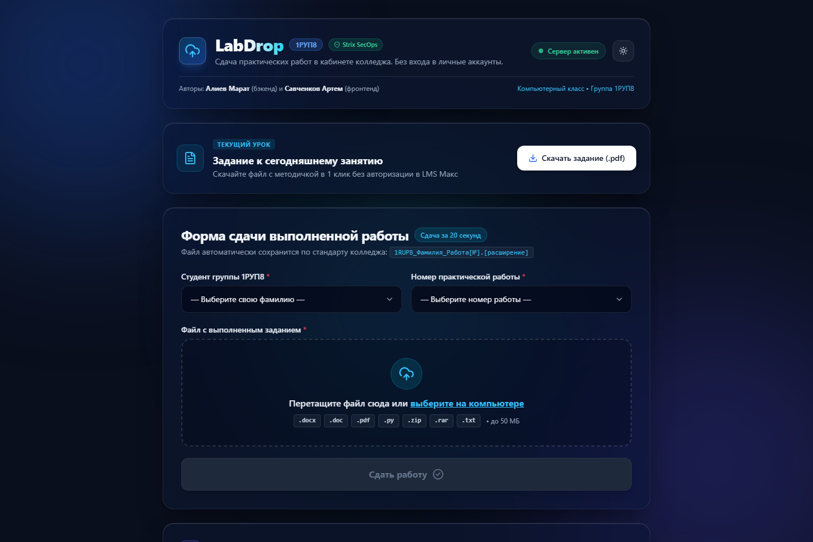
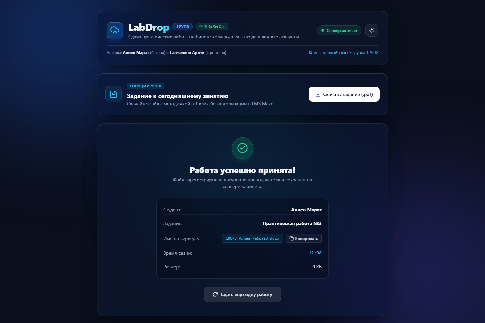
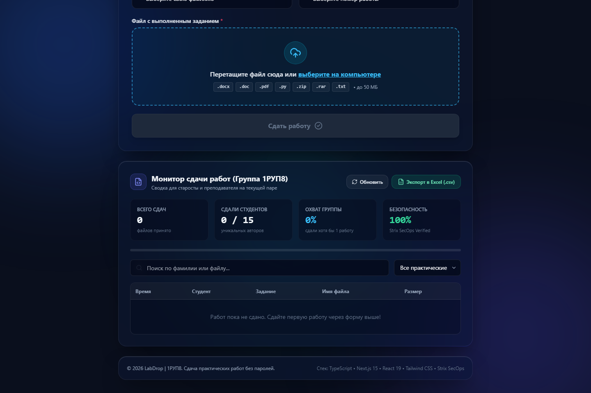
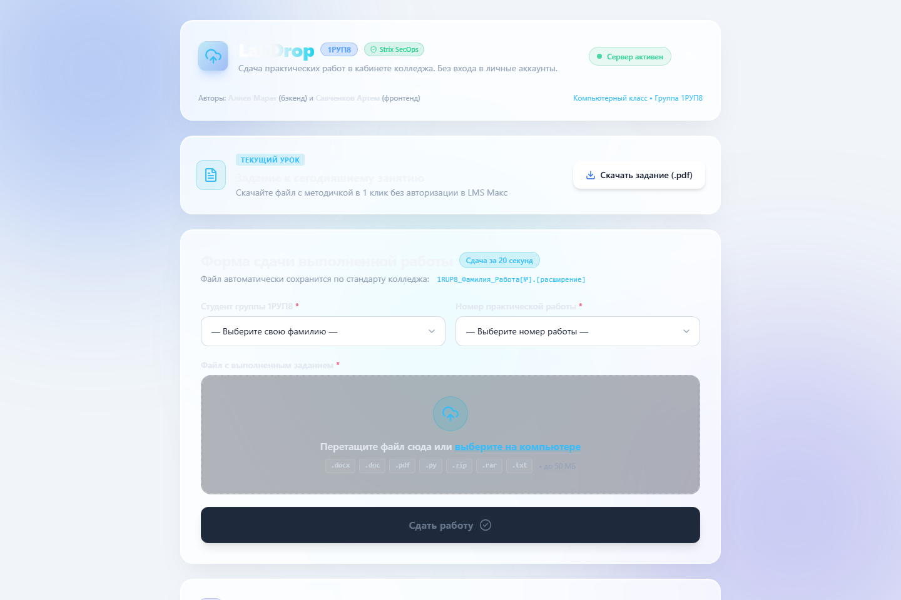
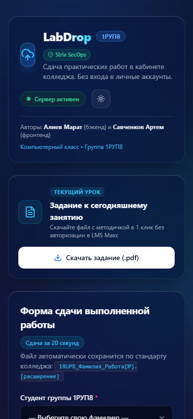

# LabDrop | 1РУП8

> **Локальный веб-сервис для мгновенной сдачи практических работ в компьютерных кабинетах колледжа без ввода логинов и паролей.**

[](https://nextjs.org/)
[]()
[-10b981.svg)]()
[]()

---

## 👥 Авторы проекта

- **Савченков Артем** — разработка фронтенда, клиентская валидация, интерфейс Glassmorphism, адаптивная верстка, тестирование пользовательских сценариев.
- **Алиев Марат** — разработка бэкенда, маршрутизация API, контроль версий Git, архитектура сохранения файлов и аудит безопасности по методике Strix SecOps.

**Учебная группа:** 1РУП8  
**Репозиторий:** [github.com/maratello1/college](https://github.com/maratello1/college)  
**Онлайн-демо (временный публичный домен):** [labdrop-1rup8.loca.lt](https://labdrop-1rup8.loca.lt) *(если запросит пароль туннеля — введите внешний IP сервера `31.77.217.78`)*

---

## 🎯 Проблема и решение

### В чем проблема на парах?
1. **Вход в аккаунты на общих компьютерах:** чтобы скачать методичку или сдать файл, студенту приходится заходить в свой личный Google Диск или мессенджер Макс (российский мессенджер) с чужого компьютера.
2. **Угроза безопасности:** на перемене студенты спешат и часто забывают выйти из личных учетных записей, оставляя доступ к личной переписке и файлам следующим группам.
3. **Потеря учебного времени:** при медленном интернете в кабинете страница авторизации мессенджера Макс или Google грузится по несколько минут. В сумме группа теряет до 15% времени урока только на логины.
4. **Хаос в названиях файлов:** студенты прикрепляют файлы с именами вроде `1.docx`, `готово.py`, `lab.pdf`. Преподавателю приходится вручную открывать каждый файл, чтобы понять, чья это работа.

### Как решает LabDrop?
- **0 авторизаций:** студент садится за компьютер, открывает страницу в локальной сети и сразу работает.
- **1 клик до задания:** кнопка «Скачать задание» моментально отдает файл текущего урока из локального каталога без входа в мессенджер Макс.
- **20 секунд на сдачу:** студент выбирает свою фамилию из выпадающего списка группы 1РУП8, номер практической (№1–№10) и перетаскивает файл в окно загрузки.
- **Автоматический стандарт именования:** сервер сам переименовывает файл в принятый стандарт:
  `1RUP8_<Фамилия>_Работа<Номер>.<расширение>` (например, `1RUP8_Алиев_Работа1.docx`).
- **Защита от перезаписи:** при повторной сдаче создается версионная копия (`1RUP8_Алиев_Работа1_v2.docx`), история сдачи сохраняется.
- **Электронный журнал для преподавателя:** каждая сдача мгновенно вносится в `submissions_log.csv` с точной датой, временем, размером и именем файла.

---

## 📸 Внешний вид и скриншоты интерфейса

Дизайн выполнен в премиальном стиле **Glassmorphism**: стеклянные полупрозрачные панели, тонкие окантовки, мягкое размытие фона (`backdrop-blur-xl`), индикаторы статуса в реальном времени и плавная анимация.

### 1. Главный экран (Темная тема)
Стеклянная карточка текущего задания, селекторы группы 1РУП8, область Drag-and-Drop и статус сервера.


### 2. Квитанция об успешной сдаче
После отправки файла форма сменяется карточкой подтверждения с зеленой анимацией, точным временем фиксации в журнале и кнопкой копирования официального имени файла в 1 клик.


### 3. Монитор преподавателя и статистика группы
В нижней части страницы преподаватель видит живую сводку: общий процент сдавших студентов группы 1РУП8, разбивку по номерам работ, поиск по фамилии и кнопку скачивания готового CSV-отчета для Excel.


### 4. Светлая тема оформления
Сервис поддерживает мгновенное переключение цветовой схемы: чистый светлый глассморфизм для светлых аудиторий.


### 5. Адаптивность для мобильных устройств
Интерфейс оптимизирован под экраны смартфонов с комфортными зонами нажатия (44x44px), динамической высотой и удобным выбором файлов.


---

## ⚡ Ключевые функции сервиса

| Функция | Описание |
|---|---|
| **Скачивание задания в 1 клик** | Отдача методички `.pdf` без регистрации и перехода в сторонние сервисы |
| **Выбор из списка 1РУП8** | 15 студентов группы по алфавиту — исключены опечатки в фамилиях |
| **Drag & Drop зона** | Поддержка перетаскивания файлов мышиным курсором и выбор через кнопку «Обзор» |
| **Мгновенная валидация** | Проверка размера (до 50 МБ), блокировка пустых файлов (0 байт) и запрещенных расширений |
| **Автоименование по стандарту** | Формирование имени `1RUP8_<Фамилия>_Работа<Номер>.<ext>` на стороне сервера |
| **Умное версионирование** | Добавление суффикса `_v2`, `_v3` при доработке или повторной сдаче |
| **Журнал для преподавателя** | Запись в `submissions_log.csv` с кодировкой UTF-8 BOM (русский язык в Excel без кракозябр) |
| **Живой монитор группы** | Динамический расчет охвата сдачи группы и быстрый фильтр по таблице |
| **Экспорт журнала** | Кнопка выгрузки файла отчета `submissions_log.csv` напрямую из браузера |

---

## 🛡️ Безопасность (Strix SecOps: 8/8 тестов)

Серверная часть и клиент полностью защищены от распространенных уязвимостей локальных сервисов:

1. **Защита от опасных расширений:** файлы `.exe`, `.bat`, `.cmd`, `.sh`, `.vbs`, `.js`, `.pyc`, `.php` блокируются на клиенте с красным предупреждением и повторно отсекаются бэкендом (HTTP 400).
2. **Защита от Path Traversal:** попытки передать имя с путями выхода (`../../`, `..\..`) автоматически нейтрализуются функцией `sanitizeFilename`.
3. **Защита от CSV/DDE Injection:** любые входящие данные, начинающиеся с формульных знаков (`=`, `+`, `-`, `@`, табуляции), экранируются одинарной кавычкой `'` перед записью в CSV, предотвращая выполнение команд в Microsoft Excel.
4. **Защита от пустых файлов (0 байт):** блокировка на уровне клиента и сервера с выводом понятной ошибки: *«Файл не содержит данных»*.
5. **Лимит размера:** жесткий потолок 50 МБ защищает накопитель сервера от переполнения.
6. **HTTP Security Headers:** добавлены заголовки `X-Content-Type-Options: nosniff`, `X-Frame-Options: DENY`, `Referrer-Policy: strict-origin-when-cross-origin`.
7. **Бот-ловушка (Honeypot):** скрытое поле в форме для отсева автоматических спам-скриптов.

Для проверки защиты реализован автоматический скрипт аудита `strix_audit.py`:
```bash
python strix_audit.py
```
**Результат аудита: 8 PASSED, 0 FAILED (100% PASS).**

---

## 💻 Стек технологий

- **Фреймворк:** [Next.js 15](https://nextjs.org/) (App Router, Server Actions & Route Handlers)
- **Библиотека интерфейса:** [React 19](https://react.dev/)
- **Язык программирования:** [TypeScript 5](https://www.typescriptlang.org/)
- **Стилизация:** [Tailwind CSS 3](https://tailwindcss.com/) + CSS Glassmorphism
- **Иконки:** [Lucide React](https://lucide.dev/)
- **Тестирование и скриншоты:** Python Playwright + Strix SecOps Test Suite
- **База данных / журнал:** Локальный журнал `submissions_log.csv` с гарантией целостности

---

## 🚀 Инструкция по установке и запуску

### 1. Клонирование репозитория
```bash
git clone https://github.com/maratello1/college.git
cd college
```

### 2. Установка зависимостей
```bash
npm install
```

### 3. Запуск в режиме разработки
```bash
npm run dev
```
Страница откроется по адресу `http://localhost:8080`.

### 4. Сборка и запуск продакшн-сервера
```bash
npm run build
npm run start
```

### 5. Доступ по локальной сети кабинета
Чтобы компьютеры кабинета могли открывать сервис:
1. Узнайте локальный IP преподавательского компьютера через `ipconfig` (например, `192.168.1.45`).
2. Запустите сервер:
   ```bash
   node ./node_modules/next/dist/bin/next start -H 0.0.0.0 -p 8080
   ```
3. Студенты открывают в браузере: `http://192.168.1.45:8080`.
